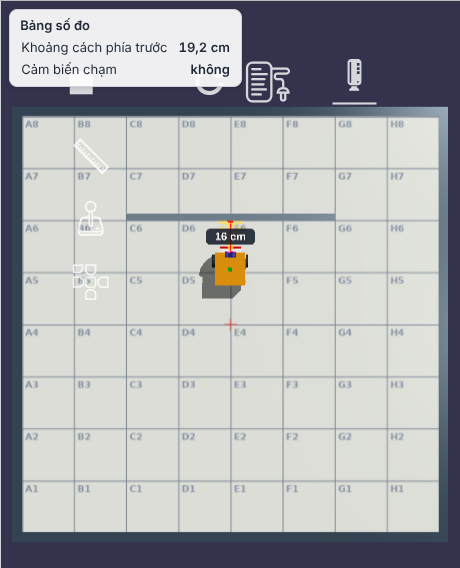
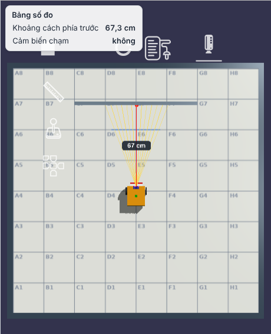
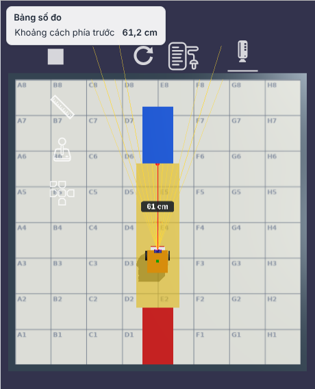
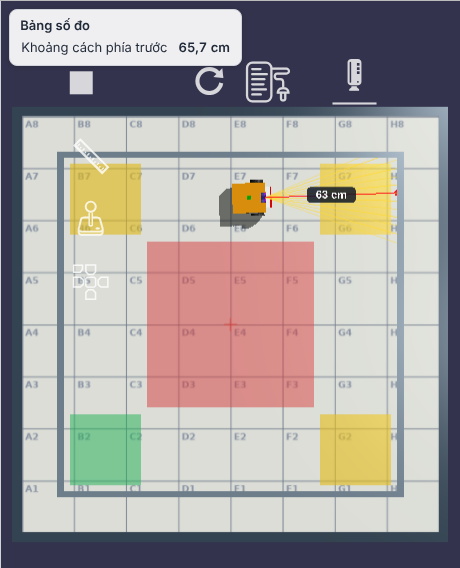
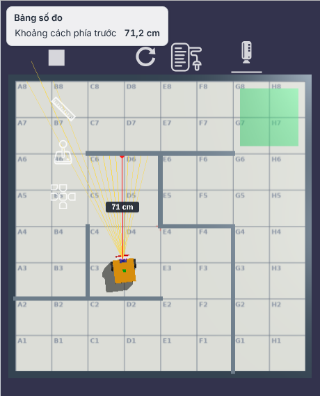

# Bài cảm biến chạm và khoảng cách (gói G6)

Tài liệu cho giáo viên. Năm bài của **chặng 3** trên sân **Lưới tọa độ** (200 × 200 cm, ô 25 cm), dùng robot chuẩn `co-ban` và chế độ khối **Cơ bản**. Thư mục bài: `public/san-robot-ao/thu-thach/03-cam-bien-cham-khoang-cach/`.

Từ chặng này robot không còn đi theo số cm tính sẵn. **Mỗi lần bấm ▶ Chạy, sân đổi phiên bản** (tường gần hay xa, xe đỗ chỗ khác, phòng to hay nhỏ, mê cung khác), nên chương trình chỉ đúng khi robot dựa vào cảm biến. Dưới khung đề ghi "Lượt này: …" để học sinh biết đang gặp phiên bản nào.

## Học sinh thấy cảm biến "nhìn" gì

Mọi bài trong chặng bật sẵn ô **"Hiện tia đo của cảm biến"** (dưới khung đề, nhớ theo trình duyệt):

- **Quạt tia vàng nhạt**: 21 tia của cảm biến khoảng cách, xòe ±21° sang hai bên.
- **Tia đỏ, chấm đỏ và nhãn số cm**: tia ngắn nhất trúng vật, chính là số cảm biến báo về chương trình.
- **Thanh cản ở mũi xe sáng vàng** khi cảm biến chạm bị nhấn.
- **Bảng số đo** ở góc trái trên sân: "Khoảng cách phía trước" và "Cảm biến chạm" cập nhật liên tục, kể cả khi robot đứng yên, nên học sinh có thể kéo robot bằng chuột tới gần tường để xem số thay đổi trước khi lập trình.

| Chạm tường | Cách tường 20 cm | Đỗ xe | Men tường | Mê cung |
|---|---|---|---|---|
|  |  |  |  |  |

Nhãn số cm trên sân đổi mỗi 2 khung hình, bảng số đo đổi 10 lần mỗi giây, nên khi robot đang chạy hai số có thể lệch nhau vài cm; lúc robot đứng yên thì trùng nhau.

## Nguyên lí dùng xuyên suốt

**1. Cảm biến chạm là một công tắc.** Thanh cản bị ép thì hai tiếp điểm chạm nhau, mạch đóng, bộ điều khiển đọc được 1 (đúng); thả ra thì 0 (sai). Cảm biến chỉ báo **đã chạm**, không báo tường còn xa bao nhiêu. Chương trình phải hỏi cảm biến liên tục (khối "chờ đến khi …", hay "lặp cho đến khi …") rồi phản ứng.

> Nói với học sinh: đi trong phòng tối, giơ tay ra trước. Tay chạm tường thì dừng bước.

**2. Cảm biến siêu âm đo thời gian tiếng vọng.** Cảm biến phát một chuỗi xung âm tần số khoảng 40 kHz (tai người nghe tới chừng 20 kHz nên không nghe thấy), rồi đo thời gian t tới lúc nhận được tiếng vọng. Âm đi tới vật và quay về, tức là đi **gấp đôi** khoảng cách:

  **d = v × t ÷ 2**, với v ≈ 343 m/s = 34 300 cm/s (không khí 20 °C).

Ví dụ: tiếng vọng về sau 1,17 ms → d = 34 300 × 0,001 17 ÷ 2 ≈ 20 cm. Tiếng vọng về sau 5,83 ms → 100 cm.
Vài điều học sinh khá giỏi có thể bàn: vận tốc âm tăng khoảng 0,6 m/s mỗi độ C nên trời nóng số đo lệch chút ít; mặt vật nghiêng quá thì sóng dội đi chỗ khác, cảm biến không nghe được tiếng vọng; vật mềm (rèm, đệm) hút âm nên khó đo. Cảm biến thật như HC-SR04 đo được khoảng 2–400 cm.

**Trong giả lập** không có sóng âm. Cảm biến bắn ra **21 tia thẳng** (raycast) hình quạt, mỗi tia tìm điểm chạm đầu tiên với vật thể, rồi lấy **tia ngắn nhất**. Tia chạm mặt quá xiên (lệch hơn khoảng 46° so với phương vuông góc) bị bỏ, giống sóng âm bị dội đi chỗ khác. Không thấy vật nào thì số đo là 255 cm. Đó chính là thứ học sinh thấy khi bật tia đo.

> Nói với học sinh: con dơi kêu "chíp" rồi nghe tiếng vọng. Tiếng vọng về càng nhanh thì vật càng gần. Hay như ném bóng vào tường: bóng bay tới rồi bay về, nên đường bóng dài gấp đôi khoảng cách tới tường.

**3. Quán tính: robot không dừng ngay.** Lệnh dừng tắt motor, nhưng robot đang có vận tốc nên còn trôi thêm một đoạn tới khi ma sát và lực hãm làm nó đứng hẳn. Động năng tỉ lệ với **bình phương vận tốc** (½mv²), nên quãng trôi cũng tăng theo v²: chạy nhanh gấp đôi thì trôi xa gần gấp bốn. Số đo trong giả lập với robot chuẩn, chương trình "chạy tới, chờ đến khi khoảng cách < N, dừng":

| Tốc độ | Vận tốc đi | Robot trôi thêm sau lệnh dừng | Muốn dừng ở 20 cm thì đặt ngưỡng |
|---|---|---|---|
| 30% | ≈ 17 cm/s | ≈ 0–0,5 cm | < 20,5 |
| 50% (mặc định) | ≈ 29 cm/s | ≈ 1–2 cm | < 21,5 |
| 100% | ≈ 44 cm/s | ≈ 6–7 cm | < 27 |

Tỉ lệ khớp với v²: (44 ÷ 29)² ≈ 2,3 và (44 ÷ 17)² ≈ 6,7. Ngoài ra chương trình chỉ đọc cảm biến vài chục lần mỗi giây, nên lúc nhận ra "< 20" thì robot đã đi quá thêm một chút; đi càng nhanh, đoạn này càng dài.

Hai cách xử lí, cả hai đều dùng trong kĩ thuật thật: **phanh sớm** (đặt ngưỡng lớn hơn đích một khoảng bằng quãng trôi) hoặc **đi chậm lại** khi gần tới (ô tô tự lái cũng giảm tốc dần trước vật cản).

> Nói với học sinh: đang chạy nhanh mà muốn dừng đúng vạch thì phải bắt đầu phanh từ trước vạch. Xe đạp đi nhanh phải bóp phanh sớm hơn xe đi chậm.

## Năm bài và buổi dạy

Chặng 3 (cảm biến) trong lộ trình 12 buổi. Lời giải mẫu dưới đây đều được kiểm tra tự động ở mọi phiên bản sân (xem cuối tài liệu).

| Buổi | Mã bài (`03-cam-bien-cham-khoang-cach/…`) | Bài | Kĩ năng mới | Lời giải mẫu |
|---|---|---|---|---|
| 1 | `01-cham-tuong-thi-dung` | Chạm tường thì dừng | cảm biến chạm, khối "chờ đến khi" | chạy tới, chờ đến khi ⟨chạm⟩, dừng, bíp (4 khối) |
| 1–2 | `02-dung-cach-tuong-20cm` | Dừng cách tường 20 cm | cảm biến siêu âm, so sánh <, quán tính | đặt tốc độ 30, chạy tới, chờ đến khi ⟨khoảng cách < 20,5⟩, dừng |
| 2 | `03-do-xe-giua-hai-xe` | Đỗ xe giữa hai xe | dùng số đo trong phép tính | đi tới ((khoảng cách − 3) ÷ 2) cm (1 khối) |
| 2–3 | `04-men-theo-tuong` | Đi men theo tường | lặp + cảm biến, một quy tắc cho mọi phòng | lặp 4 { chạy tới, chờ đến khi ⟨kc < 20⟩, dừng, quay phải 90 } (5 khối) |
| 3 | `05-thoat-me-cung-nho` | Thoát mê cung nhỏ | thuật toán bàn tay phải, lặp lồng nhau | lặp mãi { quay phải 90, lặp đến khi ⟨kc > 30⟩ { quay trái 90 }, đi tới 50 } (5 khối) |

### Bài 1. Chạm tường thì dừng
Robot ở giữa hàng 2 nhìn lên; tường dài 1 m đứng ở một trong ba chỗ (gần, vừa, xa). Học sinh đếm cm theo một lần chạy thì lần sau tường đổi chỗ và robot dừng hụt, đó là lúc hỏi "làm sao robot biết tường ở đâu?". Bài bắt buộc dùng khối "cảm biến chạm đang bị nhấn?". Sao 2: kêu bíp khi chạm (robot báo hiệu cho người). Sao 3: tối đa 4 khối.
Lỗi hay gặp: quên khối **dừng**. Robot ép vào tường mãi, bánh vẫn quay, hết 30 giây bài báo chưa đạt. Hỏi: "Robot biết đã chạm rồi, nhưng có ai bảo nó dừng chưa?"
Sai lầm khái niệm: học sinh nghĩ "chạy tới" là đi một đoạn rồi tự dừng. Thực ra khối này chỉ **bật motor** rồi chuyển ngay sang khối sau; robot chạy cho tới khi có lệnh khác.

### Bài 2. Dừng cách tường 20 cm
Tường ở ba vị trí. Vạch xanh lam trên sân cách tường đúng 20 cm để học sinh so bằng mắt. Sao 1: số đo lúc dừng từ 15 đến 25 cm. Sao 2: không chạm tường. Sao 3: từ 19 đến 21 cm.
Đây là bài để dạy quán tính. Gợi ý tiến trình:
1. Học sinh viết "chạy tới, chờ đến khi kc < 20, dừng" ở tốc độ mặc định: thường dừng ở 18–19 cm (2 sao).
2. Đổi sang tốc độ 100: robot dừng còn khoảng 14 cm, không đạt. Hỏi: "Lệnh dừng chạy đúng lúc 20 cm, vì sao robot lại dừng ở 14?"
3. Cho học sinh ghi bảng: tốc độ → số đo lúc dừng → quãng trôi. Từ bảng, em tự chọn ngưỡng phanh sớm (< 27 ở tốc độ 100) hoặc giảm tốc độ.
Mở rộng (nhóm B): đi nhanh khi còn xa, đến gần thì chậm lại (hai khối "chờ đến khi" với hai ngưỡng), vừa nhanh vừa chính xác.

### Bài 3. Đỗ xe giữa hai xe
Robot kẹp giữa xe đỏ (sau) và xe xanh (trước); đuôi robot cách xe đỏ 3 cm; khoảng hở trước là 40, 60 hoặc 80 cm tùy lượt. Đỗ "giữa" nghĩa là hở trước bằng hở sau. Đây là bài **toán lớp 6** gắn với cảm biến: gọi số đo là d, tiến x cm thì d − x = 3 + x, nên x = (d − 3) ÷ 2. Khối "đi tới … cm" nhận được cả biểu thức, nên lời giải chỉ một khối.
Sao 1: lệch giữa hai khe tối đa 8 cm (lời giải "kc ÷ 2", quên khe sau 3 cm, vẫn đạt). Sao 2: không chạm xe. Sao 3: lệch tối đa 3 cm, cần trừ 3.
Chi tiết hay để hỏi học sinh giỏi: cảm biến nằm lùi sau mũi xe khoảng 1,75 cm, nên d lớn hơn khe thật 1,75 cm và lời giải "(d − 3) ÷ 2" vẫn lệch chừng 0,9 cm. Muốn chính xác tuyệt đối: (d − 1,75 − 3) ÷ 2. Đây là việc hiệu chỉnh vị trí lắp cảm biến mà kĩ sư phải làm.

### Bài 4. Đi men theo tường
Robot ở góc dưới trái một căn phòng, tường bên tay trái, phải đi một vòng theo chiều kim đồng hồ qua 3 góc (vàng) rồi về góc xuất phát (xanh), không vào vùng đỏ giữa phòng. Phòng có ba kích cỡ (vuông 160 × 160, dài 140 × 170, bẹt 170 × 120 cm). Quy tắc: "đi tới khi thấy tường gần thì rẽ phải", lặp 4 lần.
Robot dừng cách tường trước bao nhiêu thì sau khi rẽ nó men tường bên trái cách bấy nhiêu. Khi quay tại chỗ, đuôi xe vạch một cung tròn bán kính khoảng 15–16 cm quanh điểm giữa hai bánh, nên tâm quay phải cách hai tường ít nhất chừng ấy. Ngưỡng 8 cm: đuôi xe quẹt tường ngay góc đầu, robot bị xô lệch hướng rồi lạc vào giữa phòng (0 sao). Ngưỡng 15 cm: thường qua, nhưng thỉnh thoảng quẹt ở góc cuối vì robot trôi lệch dần 2–3 cm sau mỗi cạnh dài. Ngưỡng 20 cm: an toàn ở cả ba phòng. Ngưỡng quá lớn (trên 35) thì robot đi vào vùng đỏ. Đây là chỗ tốt để học sinh tự thử và giải thích bằng hình vẽ cung quay của đuôi xe.
Sao 3 đòi khối lặp và tối đa 5 khối. Viết 16 khối rời vẫn được 2 sao.
Ghi chú: men tường "thật" (robot hút bụi, robot giữ khoảng cách với tường bên hông khi đi) cần cảm biến nhìn sang ngang và điều chỉnh liên tục. Robot chuẩn chỉ có một cảm biến nhìn trước, nên bài làm phiên bản "đi đến tường thì rẽ". Phiên bản bám tường bên hông có thể làm ở gói sau với robot có thêm cảm biến bên phải.

### Bài 5. Thoát mê cung nhỏ
Mê cung 4 × 4 ô, mỗi ô 50 cm; robot ở ô dưới trái, lối ra ở ô trên phải; có **hai mê cung** khác nhau. Robot chạm ô lối ra là lượt kết thúc (bài dùng trường `ketThucKhiVao`, nên chương trình "lặp mãi" vẫn được chấm).
Thuật toán bàn tay phải với một cảm biến nhìn trước: ở giữa mỗi ô, quay phải; chừng nào phía trước bị chắn (kc < 30 cm, vì tường cách giữa ô 25 cm còn ô trống cho số đo trên 60 cm) thì quay trái; thấy trống thì đi tới 50 cm. Ở cả hai mê cung, robot đi 10 ô và quay 19 lần, mất khoảng 85 giây ở tốc độ mặc định (giới hạn của bài là 240 giây).
Sao 2: không chạm tường. Sao 3: tối đa 6 khối; lời giải bằng "nếu … không thì" lồng ba tầng vẫn đúng nhưng dài hơn (2 sao), là dịp so sánh hai cách viết.
Hoạt động không máy: in mê cung ra giấy, học sinh dùng bút chì đi theo quy tắc bàn tay phải trước khi lập trình.

## Phân hóa

- **Nhóm A:** dùng gợi ý theo bậc (gợi ý 2 mở sau lần chạy thứ nhất, gợi ý 3 có lời giải mở sau lần thứ hai). Cho em kéo robot bằng chuột tới gần tường, đọc bảng số đo, rồi mới lập trình.
- **Nhóm B:** bài 2 làm bảng tốc độ → quãng trôi và vẽ đồ thị; bài 3 tính cả độ lệch lắp cảm biến; bài 5 thử quy tắc bàn tay trái và so số bước.

## Thay đổi trong mã

- `public/san-robot-ao/core/cam-bien.js` (mới): vẽ tia đo, làm sáng thanh cản, hai dòng "khoangCach" và "camBienCham" cho bảng số đo chung (`core/so-do.js`), luật chấm `khoangCachCuoi`, trường bài `hienTiaDo` và `ketThucKhiVao`. Tệp này không sửa `challenge-engine.js`, chỉ bọc lại hàm có sẵn. Cách tính khoảng cách giống hệt `UltrasonicSensor.getDistance()` của GEARS.
- `public/san-robot-ao/giao-dien.js`: khối **chạy tới / chạy lùi** (khi robot có gyro) tăng tốc dần trong 0,3 giây và giữ hướng theo gyro rồi mới chạy đều. Trước đây motor bật đột ngột làm bánh trượt, robot lệch 3° ở tốc độ 30% và tới 20–25° ở tốc độ 100%, đi chéo lướt qua mép tường.
- Phiên bản sân (`bienThe`) dùng phần chung trong `challenge-engine.js` (gói G7); bảng số đo dùng `core/so-do.js` (gói G5).

## Kiểm tra tự động

`scripts/thu-thach/kiem-tra-cam-bien.js` chạy lời giải mẫu và lời giải sai của cả 5 bài trên **từng phiên bản sân** (Playwright, trình duyệt không màn hình) rồi so số sao. Chạy `python3 -m http.server 1337` trong `public/`, rồi ở thư mục gốc:

```bash
node scripts/thu-thach/kiem-tra-cam-bien.js            # cả 5 bài
node scripts/thu-thach/kiem-tra-cam-bien.js 05-thoat   # một bài
```

Kết quả lần chạy gần nhất (máy ảo, 60 khung hình/giây): **41/41 trường hợp đúng số sao** ở mọi phiên bản sân. Thời gian một lượt mê cung khoảng 85 giây, nên chạy cả bộ mất chừng 25 phút.
