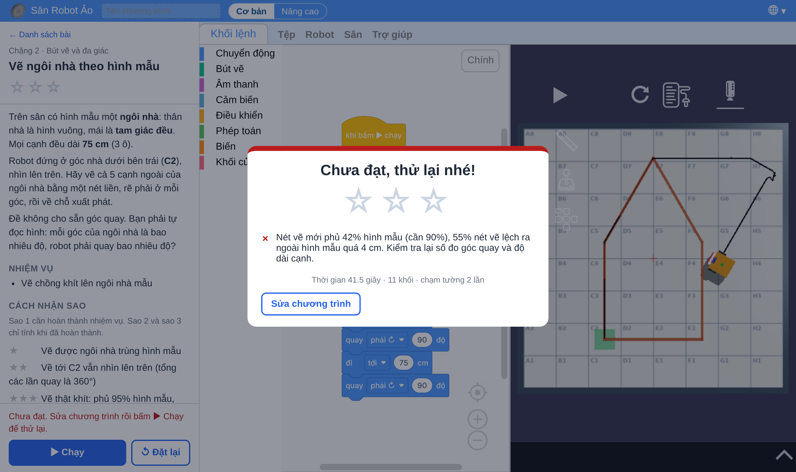
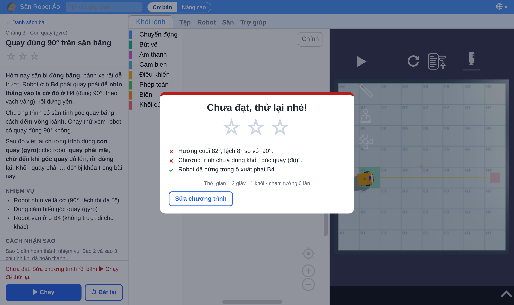
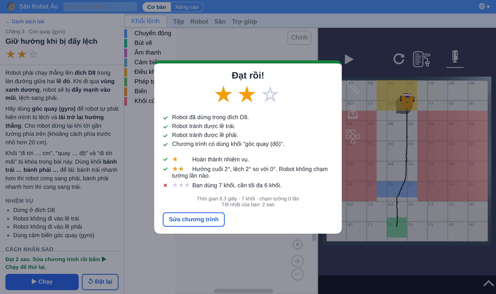

# Bài con quay (gyro) và bút vẽ (gói G8)

Tài liệu cho giáo viên. Sáu bài trên sân **Lưới tọa độ** (200 × 200 cm, ô 25 cm, cột A–H, hàng 1–8), robot chuẩn `co-ban`, chế độ khối **Cơ bản**:

- **Chặng 2 · Bút vẽ và đa giác** (`07-but-ve`): tam giác đều, lục giác đều, ngôi sao năm cánh, ngôi nhà theo hình mẫu. Dạy sau bài "Hình vuông bằng vòng lặp" (buổi 5), vào buổi 6–7.
- **Chặng 3 · Con quay** (`06-gyro`): quay đúng 90° trên sân băng, giữ hướng khi bị đẩy lệch. Dạy ở đầu chặng cảm biến (buổi 9–10), cạnh các bài cảm biến khoảng cách và màu.

Mở trang chọn bài: `san-robot-ao/` trên trang web của dự án. Giáo viên mở khóa mọi bài bằng `san-robot-ao/?moKhoa=1`.

## Nguyên lí 1. Con quay đo tốc độ quay, cộng dồn ra góc hướng

**Cách hoạt động.** Con quay MEMS trong robot (và trong điện thoại) là một khối nhỏ được cho dao động liên tục. Khi thân robot quay quanh trục đứng, **lực Coriolis** đẩy khối dao động lệch sang ngang, độ lệch tỉ lệ với **tốc độ góc** ω (độ/giây). Cảm biến chỉ đo được ω. Bộ xử lí đọc ω nhiều lần mỗi giây và **cộng dồn** (tích phân theo thời gian):

  góc hướng θ = θ₀ + Σ ω·Δt

Ví dụ: quay đều 30°/s trong 3 s thì θ tăng 90°. Đây là cùng một phép tính với "quãng đường = vận tốc × thời gian", chỉ thay đường thẳng bằng góc.

**Hệ quả 1: sai số trôi (drift).** Mỗi lần đo có một sai số nhỏ (nhiễu, lệch không). Cộng dồn hàng nghìn lần thì sai số **tích lũy**: robot đứng yên mà góc vẫn từ từ thay đổi vài độ mỗi phút ở cảm biến thật. Vì vậy khối **"đặt lại góc quay về 0"** nên đặt ngay trước động tác cần đo, và robot thật thường được để đứng yên một lúc khi khởi động để tự hiệu chỉnh. Gyro trong giả lập không có nhiễu nên gần như không trôi; giáo viên nên nói rõ điều này với học sinh để các em không ngạc nhiên khi dùng robot thật.

**Hệ quả 2: gyro đo thân, đếm vòng bánh đo bánh.** Đếm vòng bánh (encoder) chỉ biết bánh đã quay bao nhiêu. Nếu bánh **trượt**, bánh quay đủ mà thân robot chưa quay đủ. Gyro gắn trên thân nên đo đúng chuyển động của thân, bánh trượt cũng không ảnh hưởng.

**Hệ quả 3: đo đúng chưa đủ, còn phải dừng đúng.** Lệnh "dừng" chạy khi góc đã đạt 90°, nhưng thân robot còn đang quay, có **quán tính** (động năng quay) nên trôi thêm một đoạn trước khi ma sát hãm lại. Sân càng trơn, quay càng nhanh thì trôi càng xa.

> Nói với học sinh: gyro giống **tai trong** của bạn. Nhắm mắt, xoay người, bạn vẫn biết mình đã xoay bao nhiêu, vì tai trong cảm nhận chuyển động quay. Còn đếm vòng bánh giống đếm bước chân: đi trên băng, bước đủ số bước mà người vẫn chưa tới chỗ.

> Thí nghiệm nhanh trong lớp: một em ngồi ghế xoay, nhắm mắt, giáo viên quay chậm rồi dừng; em đó chỉ tay về hướng ban đầu. Quay chậm quá thì tai trong "không nhận ra" (giống cảm biến có ngưỡng); quay lâu rồi dừng đột ngột thì thấy chóng mặt, quay ngược (giống sai số tích lũy).

## Nguyên lí 2. Tổng các góc ngoài của đa giác là 360° (nối sang Toán)

Robot vẽ hình bằng cách đi dọc cạnh rồi đổi hướng ở mỗi đỉnh. Góc robot quay ở một đỉnh **không phải góc trong** của hình, mà là **góc ngoài** = 180° − góc trong (góc giữa hướng cũ và hướng mới).

Đi hết một vòng quanh đa giác lồi rồi về chỗ cũ, robot quay mặt lại đúng hướng ban đầu, tức đã quay tổng cộng **360°**. Do đó:

| Hình | Góc trong | Góc robot quay | Số lần | Tổng |
|---|---|---|---|---|
| Hình vuông | 90° | 90° | 4 | 360° |
| Tam giác đều | 60° | **120°** | 3 | 360° |
| Lục giác đều | 120° | 60° | 6 | 360° |
| Ngôi nhà (không đều) | 150°, 60°, 150°, 90°, 90° | 30°, 120°, 30°, 90°, 90° | 5 | 360° |
| Ngôi sao 5 cánh | 36° (đầu nhọn) | 144° | 5 | **720°** |

- Đa giác đều n cạnh: **góc quay = 360° : n**. Từ đó suy ra góc trong = 180° − 360°/n, và tổng góc trong = (n − 2) × 180°, đúng công thức học sinh sẽ gặp ở lớp 8.
- Ngôi sao là đa giác **không lồi**: nét vẽ quấn quanh tâm **2 vòng**, nên tổng góc quay là 2 × 360° = 720°. Quy tắc đầy đủ: tổng góc quay = 360° × số vòng quấn (trong Toán gọi là chỉ số quấn).

> Nói với học sinh: hình gì cũng vậy, bạn đi hết một vòng quanh nó và về chỗ cũ thì bạn đã xoay người đúng một vòng. Góc 60° là góc **của hình**, còn robot phải xoay **người**, xoay cho đến khi mặt nhìn dọc theo cạnh tiếp theo.

> Hoạt động gợi ý: dán băng dính một tam giác lớn trên sàn lớp. Một em đi theo cạnh, cầm thước đo góc giấy to; cả lớp đếm mỗi góc em đó xoay người bao nhiêu. Lỗi hay gặp nhất ở bài tam giác là quay 60°: cho chạy thử để thấy robot vẽ ra nửa hình lục giác.

## Sáu bài

| Buổi | Mã bài | Bài | Kĩ năng mới | Lời giải ngắn nhất |
|---|---|---|---|---|
| 6 | `07-but-ve/01-tam-giac-deu` | Vẽ tam giác đều | góc ngoài ≠ góc trong | hạ bút, lặp 3 { đi 100, quay phải 120 } (4 khối) |
| 6 | `07-but-ve/02-luc-giac-deu` | Vẽ lục giác đều | góc quay = 360° : n | hạ bút, lặp 6 { đi 50, quay phải 60 } (4 khối) |
| 7 | `07-but-ve/03-ngoi-sao-5-canh` | Vẽ ngôi sao năm cánh | tổng góc quay 720° | hạ bút, lặp 5 { đi 100, quay phải 144 } (4 khối) |
| 7 | `07-but-ve/04-ve-ngoi-nha-theo-mau` | Vẽ ngôi nhà theo hình mẫu | tự đọc góc từ hình, kiểm tra tổng 360° | hạ bút + 5 × (đi 75, quay) (11 khối) |
| 9 | `06-gyro/01-quay-90-do-tren-san-bang` | Quay đúng 90° trên sân băng | đọc gyro, chờ đến khi, quán tính | đặt lại góc, quay phải mãi, chờ đến khi góc > 90, dừng (4 khối, tốc độ thấp) |
| 10 | `06-gyro/02-giu-huong-khi-bi-day` | Giữ hướng khi bị đẩy lệch | điều khiển phản hồi | đặt lại góc, lặp đến khi gần tường { nếu góc > 0 thì lái trái, nếu không lái phải }, dừng (6 khối) |

### Bài vẽ: chấm bằng hình mẫu trên sân




Mỗi bài vẽ có **hình mẫu** vẽ sẵn trên sân (xám, vàng hoặc cam). Robot hạ bút và vẽ chồng lên. Khi chạy xong, bài so nét vẽ với hình mẫu (xem mục "Cách chấm nét vẽ" bên dưới) và báo cho học sinh nét vẽ phủ bao nhiêu phần trăm hình mẫu, lệch ở đâu. Sao 2 của mọi bài vẽ đòi robot **về tới chỗ xuất phát và nhìn lại đúng hướng ban đầu**: học sinh quên lần quay cuối vẫn vẽ đủ hình (1 sao) nhưng không được sao 2, đó là lúc hỏi "robot đã quay tổng cộng bao nhiêu độ?".

**Bài 1. Tam giác đều.** Cạnh 100 cm, xuất phát B2 nhìn lên, rẽ phải. Học sinh quay 60° sẽ thấy robot vẽ ra ba cạnh của lục giác và bài báo "nét vẽ mới phủ …% hình mẫu". Sao 3: dùng vòng lặp, tối đa 4 khối.

**Bài 2. Lục giác đều (tổ ong).** Cạnh 50 cm. Đề không cho góc quay, chỉ cho góc trong 120° và nhắc lại bài tam giác: học sinh tự suy ra 360° : 6 = 60°, rồi kiểm tra lại bằng 180° − 120°. Hai đường cho cùng đáp số là chỗ đáng dừng lại thảo luận.

**Bài 3. Ngôi sao năm cánh.** 5 đoạn 100 cm, góc đầu nhọn 36°, robot quay 144°. Robot xuất phát đã nhìn sẵn về đỉnh trên cùng (hướng 18°), nên sao 2 đòi kết thúc ở hướng 18° chứ không phải 0°. Câu hỏi lớn của bài: vì sao tổng là 720° mà không phải 360°? Cho học sinh dùng ngón tay lần theo nét sao trên màn hình và đếm số vòng ngón tay đi quanh tâm.

**Bài 4. Vẽ ngôi nhà theo hình mẫu.** Thân nhà vuông, mái tam giác đều, mọi cạnh 75 cm. Đề **không cho góc quay**: học sinh tự đọc hình (góc chân mái = 90° + 60° = 150°, quay 30°; đỉnh mái 60°, quay 120°; hai góc dưới quay 90°) và tự kiểm tra 30 + 120 + 30 + 90 + 90 = 360 trước khi chạy. Sao 3 đòi vẽ khít hơn (phủ 95%, lệch không quá 3 cm).
Mở rộng nhóm B: vẽ thêm cửa ra vào bằng khối **nhấc bút** / **hạ bút** (ngoài phần chấm).

### Bài 5. Quay đúng 90° trên sân băng



Sân được đặt hệ số ma sát 0,08 (sân thường là 1) và phủ màu xanh băng. Bài mở sẵn chương trình **đếm vòng bánh**: quay 90° thì mỗi bánh lăn ¼ vòng tròn đường kính 16 cm (khoảng cách hai bánh) = 12,6 cm = 0,63 vòng bánh. Trên sân thường cách này đúng; trên sân băng bánh trượt nên robot chỉ quay khoảng **80–84°**. Học sinh chạy, đọc thông báo "hướng cuối …°", rồi viết lại bằng gyro.

Khối "quay phải … độ" bị khóa (chính khối đó đã dùng gyro bên trong, xem bài 6). Lời giải đầu tiên học sinh hay viết:

```
đặt lại góc quay về 0
quay phải mãi
chờ đến khi  góc quay (độ) > 90
dừng lại
```

Ở tốc độ mặc định 50% robot trôi quá đà, dừng ở khoảng **135°**: gyro đo đúng nhưng robot không phanh kịp trên băng (quán tính). Hai cách sửa, cũng là hai bậc sao:

- **Sao 1–2 (lệch ≤ 5° / ≤ 2°):** quay chậm lại (đặt tốc độ 10%, robot dừng ở khoảng 93°), hoặc ra lệnh dừng sớm hơn (chờ đến khi góc > 80) rồi chỉnh dần theo số đo. Cả hai đều là **bù sai số bằng thực nghiệm**.
- **Sao 3 (lệch ≤ 2° trong tối đa 2 giây):** tốc độ 10% thì chính xác nhưng chậm (khoảng 2,7 giây). Phải **quay nhanh rồi chậm dần**: tốc độ 40% đến 45°, rồi 10% đến 88° (khoảng 1,5 giây). Đây đúng là cách các bộ điều khiển thật làm (khối "quay … độ" của Sân Robot Ảo cũng giảm tốc khi gần tới góc đích).

Câu hỏi thảo luận: vì sao sân càng trơn robot càng trôi xa sau khi dừng? (Lực ma sát là lực hãm; ma sát nhỏ thì lực hãm nhỏ, động năng quay mất lâu hơn mới hết.)

### Bài 6. Giữ hướng khi bị đẩy lệch



Robot chạy từ D1 lên đích D8 trong làn đường giữa hai lề đỏ. Khi đi qua vùng xanh dương, robot bị một **xung lực** đẩy ngang vào mũi (trường `cuDay` của bài), lệch khoảng 23° sang phải. Khối "đi tới", "quay" và "đi tới mãi" bị khóa (chúng đã tự giữ hướng bằng gyro bên trong); học sinh lái bằng khối mới **bánh trái … % bánh phải … %**.

- Không sửa hướng (bánh trái 50, bánh phải 50): robot đi chéo, lấn lề phải, bài báo "Robot đã đi vào lề phải".
- Lời giải **điều khiển bật/tắt** (bang-bang):

```
đặt lại góc quay về 0
lặp cho đến khi  khoảng cách phía trước (cm) < 20
    nếu  góc quay (độ) > 0  thì
        bánh trái 30 %  bánh phải 50 %      (lệch phải → cong về trái)
    nếu không
        bánh trái 50 %  bánh phải 30 %
dừng lại
```

Robot về lại hướng 0° nhưng vẫn lệch khỏi giữa làn khoảng 10–13 cm: gyro chỉ đo được **phần xoay**, không đo được **phần trượt ngang** của cú đẩy. Đây là giới hạn đáng cho học sinh tự phát hiện: "muốn về giữa làn thì cần cảm biến gì nữa?" (cảm biến khoảng cách hai bên, cảm biến màu dò vạch…).

- Nhóm B: thay bật/tắt bằng **điều khiển tỉ lệ**: bánh trái = 50 − k × góc, bánh phải = 50 + k × góc (lệch càng nhiều sửa càng mạnh). Trong giả lập, k = 0,5; 1 và 3 đều đưa robot về đích, hướng cuối lệch dưới 3°; k lớn thì sửa nhanh hơn. Trên robot thật, k lớn quá làm robot lắc qua lắc lại vì động cơ và cảm biến cần thời gian mới phản ứng kịp (dao động do trễ, giống chỉnh vòi sen nóng lạnh). Cho nhóm B thử nhiều k và mô tả quỹ đạo vết bút.

Nối lại với bài 5: khối "đi tới … cm" học sinh dùng từ buổi 1 làm đúng việc này bên trong, đọc gyro liên tục và chỉnh hai bánh (điều khiển tỉ lệ), nên robot đi thẳng được.

> Nói với học sinh: giống đạp xe khi có gió ngang. Bị thổi lệch thì bạn bẻ lái ngược lại, và không phải bẻ một lần là xong mà sửa liên tục, nhìn, chỉnh, nhìn, chỉnh.

## Cách chấm nét vẽ so với hình mẫu

Điều kiện `veGiongMau` (tệp `core/net-ve.js`) so hai tập đường cong:

1. **Ghi nét vẽ.** Trong lúc chạy, mỗi khung hình đọc vị trí đầu bút; khi bút đang hạ và đầu bút đã đi thêm 0,5 cm thì ghi một điểm. Nhấc bút rồi hạ lại thì bắt đầu một nét mới.
2. **Hình mẫu** khai báo bằng đường đi của một "robot mẫu" trong tệp bài, ví dụ tam giác: `"buoc": [["lap", 3, [["di", 100], ["phai", 120]]]]`, rồi được tính ra tọa độ và vẽ lên sân. Giáo viên tự làm bài vẽ mới không cần tính tọa độ.
3. **So hai chiều**, lấy điểm cách đều 1 cm dọc mỗi đường:
   - **Độ phủ** = bao nhiêu % điểm của hình mẫu có nét vẽ đi qua gần nó (cách không quá `saiSo` cm, mặc định 4 cm). Thiếu cạnh thì độ phủ thấp.
   - **Độ chính xác** = bao nhiêu % điểm của nét vẽ nằm gần hình mẫu. Vẽ thừa, vẽ lệch ra ngoài thì độ chính xác thấp.
   - Đạt khi cả hai ≥ ngưỡng (mặc định 90%).

Cần cả hai chiều: chỉ đòi độ phủ thì tô kín cả sân cũng đạt; chỉ đòi độ chính xác thì vẽ một đoạn ngắn đúng chỗ cũng đạt. Cách đo này giống cách chấm điểm "hai phía" dùng trong nhận dạng hình ảnh (khoảng cách Chamfer, độ đo F). Sai số 4 cm là rộng tay so với độ chính xác của robot chuẩn (±1 cm, ±2° mỗi động tác), đủ để sai số nhỏ tích lũy qua nhiều cạnh không làm học sinh trượt oan, nhưng quay sai 10° trên cạnh 100 cm (lệch 17 cm) là trượt.

Thông báo cho học sinh nói rõ chỗ hỏng: "Nét vẽ mới phủ 64% hình mẫu: robot vẽ được 300 cm, hình mẫu dài 500 cm. Còn thiếu cạnh nào?" hoặc "Có 35% nét vẽ lệch ra ngoài hình mẫu quá 4 cm. Kiểm tra lại số đo góc quay và độ dài cạnh."

Bảng kết quả kiểm thử thật (độ phủ, độ chính xác của lời giải mẫu và lời giải sai) ở mục "Kiểm tra tự động".

## Phân hóa

- **Nhóm A:** dùng gợi ý theo bậc trong bài (gợi ý 2 mở sau lần chạy thứ nhất, gợi ý có lời giải mở sau lần thứ hai). Ở bài vẽ, cho các em đi thử hình trên sàn lớp trước khi kéo khối. Ở bài gyro, phát sẵn bảng ghi "tốc độ – góc dừng lại" để các em chạy 3 lần ở 3 tốc độ và ghi số.
- **Nhóm B:** bài vẽ: tự viết khối của tôi "vẽ đa giác (n, cạnh)" dùng góc 360/n; vẽ ngôi sao 7 cánh (quay 360 × 3 / 7 ≈ 154,3°) ngoài bài chấm. Bài gyro: quay nhanh rồi chậm (sao 3 bài 5), điều khiển tỉ lệ (bài 6), so sánh k = 0,5; 1; 2.

## Phần mới trong mã nguồn

- **Hai khối mới** (chế độ Cơ bản, nhóm Chuyển động): **quay phải/trái mãi** (`sra_xoay`) và **bánh trái … % bánh phải … %** (`sra_banh`).
- **Lọc khối ở chế độ Cơ bản:** trường `locKhoi` chỉ có `deny` nay ẩn khối ngay trong bảng Cơ bản, không còn chuyển sang Nâng cao.
- **`core/net-ve.js`:** hình mẫu (`hinhMau`), ghi nét vẽ, điều kiện `veGiongMau`.
- **`core/vat-li-san.js`:** mặt sân trơn (`matSan.maSat`) và cú đẩy (`cuDay`). Tệp này cũng sửa một lỗi làm tròn của Babylon: góc quay bánh xe đôi khi thành NaN sau nhiều lần quay (gặp khi vẽ ngôi sao), làm lượt chạy không bao giờ kết thúc.
- Cách khai báo các trường mới: [huong-dan-them-bai.md](huong-dan-them-bai.md).

## Kiểm tra tự động

`scripts/thu-thach/kiem-tra-bai.js` có thêm lời giải đúng và sai cho cả sáu bài. Chạy `python3 -m http.server 1337` trong `public/`, rồi `node scripts/thu-thach/kiem-tra-bai.js 06-gyro/01-quay-90-do-tren-san-bang` (hoặc bỏ mã bài để chạy tất cả).

Kết quả lần chạy ngày 13/11/2026 (38/38 trường hợp đúng số sao, kể cả 6 bài của G4):

| Bài | Lời giải | Sao | Thông báo cho học sinh / số đo |
|---|---|---|---|
| Tam giác | lặp 3 { đi 100, quay phải 120 } | 3 | về B2, hướng 0° |
| Tam giác | 7 khối, không lặp | 2 | "Chương trình chưa dùng khối lặp lại … lần" |
| Tam giác | quay 60° (nhầm góc trong) | 0 | "Nét vẽ mới phủ 36% hình mẫu, 64% nét vẽ lệch ra ngoài hình mẫu quá 4 cm" |
| Tam giác | quên hạ bút | 0 | "Robot chưa vẽ gì cả. Bạn đã dùng khối hạ bút chưa?" |
| Lục giác | lặp 6 { đi 50, quay phải 60 } | 3 | |
| Lục giác | lặp 5 lần (thiếu một cạnh) | 0 | "Nét vẽ mới phủ 86% hình mẫu: robot vẽ được 251 cm, hình mẫu dài 300 cm. Còn thiếu cạnh nào?" |
| Lục giác | quay 120° | 0 | phủ 20% |
| Ngôi sao | lặp 5 { đi 100, quay phải 144 } | 3 | về chân trái, hướng 18° (đã quay 720°) |
| Ngôi sao | quay 36° / quay 72° (ngũ giác) | 0 | phủ 25% / 35% |
| Ngôi nhà | 30–120–30–90–90 | 3 | đạt cả mức khít 3 cm, 95% |
| Ngôi nhà | quên lần quay cuối | 2 | "Hướng cuối 270°, lệch 90°" |
| Ngôi nhà | mái quay 60° | 0 | phủ 42% |
| Sân băng | đếm vòng bánh (chương trình có sẵn) | 0 | robot dừng ở 80° |
| Sân băng | gyro, tốc độ 50% | 0 | quá đà tới 136° |
| Sân băng | gyro, tốc độ 10% | 1 | 93°, 2,7 giây |
| Sân băng | gyro 10%, dừng khi góc > 87 | 2 | 90°, 2,5 giây |
| Sân băng | 40% tới 45°, rồi 10% tới 88° | 3 | 91°, 1,5 giây |
| Bị đẩy | lái bật/tắt theo gyro | 3 | lệch 23–27° sau cú đẩy, về hướng 0–2°, tới đích |
| Bị đẩy | bánh 50/50, không sửa | 0 | "Robot đã đi vào lề phải", hướng cuối 26° |

Các số đo góc dao động 1–3° giữa các lần chạy (vật lí của giả lập không hoàn toàn lặp lại), nên ngưỡng sao đã chừa khoảng an toàn.
