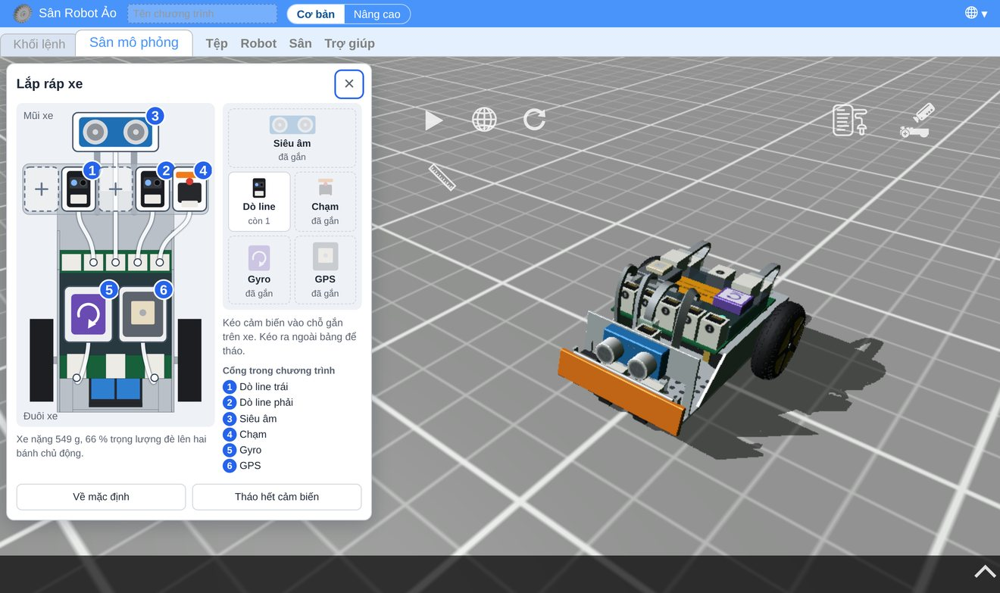
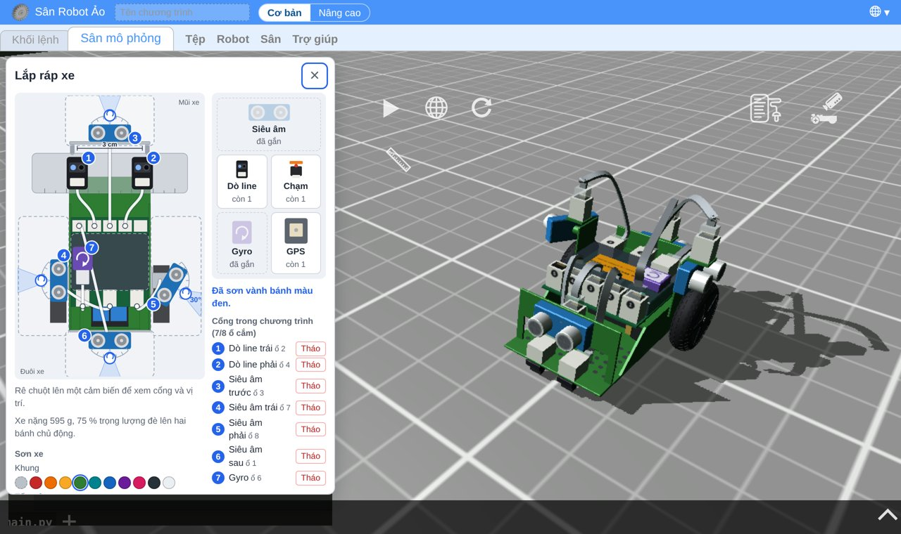

# Xe lắp mô-đun

Xe 2 bánh kiểu xe kit bán lẻ (khung nhôm, motor giảm tốc TT, mạch chủ có nắp, cảm biến dạng mô-đun nối bằng dây RJ25). Toàn bộ hình 3D, hitbox, khối lượng và mô phỏng cảm biến trong thư mục này là mã viết riêng cho Sân Robot Ảo, không dùng thân hộp, bánh và cảm biến có sẵn của GEARS.

Đã có: khung, bánh thường, cảm biến (dò line, màu, siêu âm, chạm, gyro, GPS), servo, bút vẽ và bảng lắp ráp kéo thả. Chưa có: nam châm, kẹp gắp, cánh tay, súng bắn bóng, laze, lidar, camera, bánh omni, mecanum, bánh to và bánh nhỏ.

Xe này là robot của mọi sân: robot cũ của GEARS (robot chuẩn `co-ban` và các robot bài học) đã bỏ khỏi các bài. Mỗi bài lắp xe theo tệp code mẫu của bài (`code-mau/<mã-bài>.json`, trường `xe`).


## Dùng thử

- Menu **Robot → Chọn robot → Xe lắp mô-đun (2 bánh)**.
- Mở một bài: `index.html?baiTap=01-di-chuyen/01-tien-toi-o-dich`. Thêm `&xe=mau` thì vùng khối mở sẵn chương trình mẫu của bài.
- Tháo lắp cảm biến: menu **Robot → Lắp ráp xe (kéo thả cảm biến)**.
- Xem hitbox: menu **Robot → Hiện hitbox của xe** (khung dây xanh lá).

Robot nào có trường `sraXe` trong tệp JSON thì được dựng bằng mã ở đây. `robots/xe-lap-rap.js` (sinh cùng tệp .json bằng `node scripts/robot/tao-xe.js`) đưa xe lên đầu danh sách robot, nên xe là robot mặc định ngay khi trang mở, ở mọi sân.

## Các tệp

| Tệp | Việc |
|---|---|
| `hinh-khoi.js` | Toán: khối đặc (hộp, trụ, cầu, lăng trụ đáy lồi), thể tích, trọng tâm, mô-men quán tính, khoảng cách tới mặt khối. Không phụ thuộc trình duyệt, chạy được bằng Node. |
| `linh-kien.js` | Danh mục linh kiện và hàm `lapXe(cấu hình)`: mỗi chi tiết là một danh sách khối đặc kèm vật liệu và khối lượng. |
| `dung-hinh.js` | Sinh lưới 3D từ các khối (vát cạnh, nhãn, lưới loa siêu âm, gai lốp, nan vành, dây). |
| `vat-li.js` | Vật thể, khớp, motor và bước tính vật lí (Bullet qua Ammo.js). |
| `cam-bien.js` | Mô phỏng 5 loại cảm biến theo nguyên lí linh kiện thật. |
| `xe.js` | Nối xe vào GEARS: nạp robot, giao diện bánh và cảm biến mà khối lệnh, Python đang dùng. |
| `bang-lap-rap.js`, `.css` | Bảng lắp ráp: khay linh kiện, sơ đồ xe, kéo thả, lưu bản lắp của người dùng. |

Một bản mô tả khối duy nhất sinh ra cả ba thứ: hình nhìn thấy, hình va chạm, khối lượng. Vì vậy sửa kích thước một chi tiết ở `linh-kien.js` thì ba thứ cùng đổi.

Sau khi sửa `linh-kien.js`, chạy `node scripts/robot/tao-xe.js` để sinh lại `robots/xe-lap-rap.json`.

## Linh kiện của xe mặc định

Hệ trục xe: gốc ở mặt sân, ngay dưới điểm giữa trục hai bánh; x sang phải, y lên, z ra trước. Đơn vị cm, gam, giây.

| Nhóm | Chi tiết | Khối lượng |
|---|---|---|
| Khung | Khung nhôm chữ U dày 2 mm, tấm đáy 9 × 17 cm | 149 g |
| Động cơ | 2 motor giảm tốc TT 1:48 | 2 × 29 g |
| Pin | Hộp 2 pin 18650 | 104 g |
| Mạch chủ | Mạch in, nắp, 8 ổ RJ25, 4 trụ đồng | 56 g |
| Bánh | 2 bánh Ø 6,37 cm (chu vi 20 cm), rộng 1,8 cm, lốp cao su mặt cắt tròn | 2 × 29 g |
| Bi tự do | Bi thép Ø 1,6 cm và vỏ | 17 g + 6 g |
| Dò line | 2 mô-đun TCRT5000, cách nhau 3 cm, mặt đo cao 6 mm; đầu phát và đầu thu xếp dọc thân xe (đầu phát phía mũi) | 2 × 7,5 g |
| Siêu âm | HC-SR04 và giá đỡ | 25 g |
| Chạm | Công tắc hành trình, tấm cản có bản lề và lò xo | 9 g + 10 g |
| Gyro, GPS | Hai mô-đun đặt trên nắp mạch chủ | 6 g, 13 g |
| Dây | 6 dây RJ25 dẹt | 21 g |

Cả xe 549 g, 273 khối va chạm. Hai bánh cách nhau 11,4 cm (tâm đến tâm). Trọng tâm cao 3,6 cm, nằm trước trục bánh 3,5 cm; khoảng hai phần ba trọng lượng đè lên hai bánh chủ động.

| Cổng | Thiết bị |
|---|---|
| A (`outA`) | Bánh trái |
| B (`outB`) | Bánh phải |
| 1, 2 | Dò line trái, phải (lỗ thứ 2 và thứ 4 dưới mũi xe) |
| 3 | Siêu âm |
| 4 | Chạm (công tắc ở lỗ thứ 5) |
| 5 | Gyro |
| 6 | GPS |

## Chỗ gắn cảm biến và bảng lắp ráp





Xe có 7 vùng gắn cảm biến: bốn giá siêu âm (mũi, trái, phải, đuôi), thanh dưới mũi, nắp mạch chủ và gầm xe. Trong mỗi vùng, cảm biến đặt ở vị trí bất kì trên lưới 0,5 cm. Mạch chủ có 8 ổ cắm nên xe gắn được nhiều nhất 8 cảm biến; đủ 8 thì khay khoá lại và ghi "hết ổ".

| Vùng gắn | Nhận | Giới hạn | Ổ trên mạch chủ |
|---|---|---|---|
| Giá phía mũi | Siêu âm | Trượt ngang trong thanh giá (±2,1 cm khi nhìn thẳng, hẹp lại khi xoay), xoay quanh trục đứng ±45° | Ổ trước còn trống gần nó nhất |
| Giá bên trái, bên phải | Siêu âm | Tấm nhôm bắt vào vách bên; trượt dọc thân (z từ −2,5 đến 8 cm), xoay ±45° | Ổ còn trống gần nó nhất |
| Giá phía đuôi | Siêu âm | Tấm nhôm sau đuôi xe; trượt ngang như giá mũi, xoay ±45° | Ổ còn trống gần nó nhất |
| Thanh dưới mũi xe | Mắt dò line (nhiều nhất 3), công tắc chạm (nhiều nhất 1) | x từ −3 đến 3 cm; hai mô-đun cách nhau (tâm đến tâm) ít nhất 1,5 cm | Ổ 1 đến 5, xếp theo thứ tự trái sang phải để dây không bắt chéo |
| Gầm xe (dưới tấm đáy) | Mắt dò line (nhiều nhất 4) | Tâm mạch: x từ −3,75 đến 3,75 cm, z từ −0,5 đến 10,5 cm; không lấn vào vỏ bi tự do; hai mắt lệch nhau ít nhất 1,5 cm theo bề ngang vì dây mỗi mắt chạy thẳng dọc gầm ra đuôi | Ổ còn trống gần đuôi xe nhất |
| Nắp mạch chủ | Gyro, GPS, servo SG90 (nhiều nhất 1) | Cả mô-đun lẫn ổ cắm phía sau nằm gọn trên nắp, hai mô-đun không chồng nhau | Ổ 6 đến 8, theo thứ tự trái sang phải |
| Tay quay của servo | Siêu âm, mắt dò line | Mỗi đầu tay quay một cảm biến, hai cảm biến không chồng nhau; tính chung giới hạn khay (4 siêu âm, 7 mắt dò line) | Ổ còn trống gần servo nhất |

Bảng lắp ráp làm theo cách kéo thả của Tinkercad:

- **Bám lưới.** Vị trí làm tròn theo bước 0,5 cm; giữ Alt khi thả thì bước 0,1 cm. Góc xoay bám 15°; giữ Shift thì bám 45°, giữ Alt thì 5°.
- **Hút.** Thả gần một cảm biến khác (chỗ đó không đủ rộng) thì cảm biến tự trượt tới chỗ trống gần nhất trong 1,5 cm. Thả ngay lên một cảm biến khác cùng vùng thì hai cảm biến đổi chỗ; kéo từ khay thả lên thì cảm biến cũ về khay.
- **Xem trước.** Trong lúc kéo, vùng nhận được tô xanh và sơ đồ vẽ luôn kết quả nếu thả ở đó: bóng mờ của cảm biến, dây, số cổng, thước đo. Chỗ không thả được hiện bóng đỏ kèm lời giải thích.
- **Thước đo.** Trên thanh dưới mũi có vạch 0,5 cm, trục giữa xe và khoảng cách giữa các cảm biến cạnh nhau.
- **Thông tin.** Rê chuột lên một cảm biến thì dòng dưới sơ đồ ghi vị trí, số cổng, ổ cắm, và dây của nó sáng lên.
- **Nhiều siêu âm.** Có 4 cảm biến siêu âm trong khay, mỗi giá gắn một cái. Kéo siêu âm từ giá này sang giá đang có siêu âm khác thì hai cái đổi chỗ.
- **Độ cao siêu âm.** Mục "Độ cao siêu âm" có nút − và + (bước 0,5 cm) cho từng cảm biến; hoặc Tab tới cảm biến rồi bấm PageUp/PageDown. Độ cao là tâm cảm biến so với mặt sân: giá mũi 5,6 đến 10,6 cm (thấp hơn thì đụng công tắc chạm), giá bên 7,5 đến 13 cm khi cảm biến nằm ngang bánh xe, còn khi dời lên phía mũi qua khỏi bánh (z từ khoảng 6 cm khi nhìn thẳng, xa hơn khi xoay) thì hạ được tới 3 cm. Dời cảm biến thấp lùi về ngang bánh thì nó tự nâng lên 7,5 cm và bảng báo lại, giá đuôi 3 đến 10,6 cm. Giá kéo dài hoặc thòng xuống theo cảm biến. Độ cao thuộc về giá: kéo cảm biến sang giá khác thì nó lấy độ cao của giá đó.
- **Xoay siêu âm.** Mỗi siêu âm có núm tròn riêng trên cung phía trước nó. Mô-đun bắt vào giá qua một chốt xoay; khi xoay, mô-đun được đẩy ra trước vừa đủ để vỏ không lấn vào thanh giá.
- **Tháo từng cảm biến.** Rê chuột lên cảm biến (hoặc Tab tới nó) thì hiện nút × đỏ ở góc; bấm để tháo. Danh sách cổng cũng có nút "Tháo" cạnh mỗi cảm biến. Trên màn hình cảm ứng nút × luôn hiện.
- **Chế độ đọc mắt dò line.** Phía trên "Sơn xe" có hai nút, áp dụng cho mọi mắt dò line của xe (dưới mũi, dưới gầm, trên tay quay servo):
  - *Tương tự (A0)*, mặc định: chương trình đọc mức 0 đến 100 (khối "độ sáng phản xạ", `reflected_light_intensity`). Trước mỗi mắt có đèn cam: tín hiệu yếu thì đèn nhạt, gần như trong suốt; tín hiệu càng mạnh đèn càng đậm.
  - *Số (D0)*: chương trình chỉ đọc 0 (vạch tối) hoặc 100 (nền sáng), là ngõ ra của mạch so sánh (ngưỡng 0,5, trễ ±0,03). Đèn xanh lá trước mỗi mắt sáng khi ngõ ra bật, tắt (xám) khi gặp vạch, như đèn báo D0 trên mô-đun thật. Nền xám có thể ra 0 hoặc 100 tuỳ nó ở bên nào của ngưỡng.
  - Đèn chỉ để nhìn: không có khối lượng, cảm biến không thấy nó, và luôn vẽ đè lên xe để thấy được cả khi bị khung hay tấm cản che. Cấu hình ghi `"ir": "so"` hoặc `"ir": "tuongTu"`; "Tháo hết cảm biến" giữ chế độ, "Về mặc định" trả về tương tự.
- **Sơn xe.** Dưới sơ đồ có ba hàng ô màu cho khung, tấm cản và vành bánh (10 màu, ô viền đứt là màu gốc). "Tháo hết cảm biến" giữ màu sơn; "Về mặc định" trả về màu gốc.
- **Nhìn gầm xe.** Phía trên sơ đồ có hai nút "Nhìn từ trên" và "Nhìn gầm xe". Nhìn gầm thì sơ đồ vẽ gầm xe từ dưới lên, đúng tỉ lệ (không lật trái phải: bên trái sơ đồ vẫn là bên trái xe), chỉ còn vùng gầm để thả mắt dò line, còn máy quay 3D hạ xuống dưới mặt sân (mặt sân tự trong suốt nhẹ) để thấy gầm. Mỗi mắt dưới gầm gồm mạch đầu đo treo dưới tấm đáy và ổ RJ25 ngay phía sau mạch (đáy ổ cách sân 5 mm); dây chạy dọc gầm ra quá vách đuôi, vòng lên sát mặt ngoài vách rồi tới ổ trên mạch chủ.
- **Servo.** Kéo servo từ khay lên nắp mạch chủ thì bên trái bảng hiện mục "Servo (động cơ C)":
  - *Hướng*: "Trục đứng" (tay quay quét ngang, từ phải qua trước sang trái), "Trục nằm dọc" (trục dọc thân xe, tay quay lắc từ phải lên đỉnh sang trái), "Trục nằm ngang" (trục ngang thân xe, tay quay gật từ trước lên đỉnh ra sau). Nút − + ở *Nghiêng* (0 đến 90°) và *Xoay* (−180 đến 180°, dương là sang trái) cho hướng tuỳ chọn, bước 15°.
  - *Tay quay*: đơn (1 đầu, dài 1,9 cm), đôi (2 đầu đối nhau), chữ thập (4 nhánh ngắn), đĩa tròn (gắn 1 cảm biến ở tâm).
  - Mỗi đầu tay quay chọn Trống, Siêu âm hoặc Dò line. Nút bị khoá kèm lí do khi hai cảm biến chồng nhau hoặc khay đã hết loại đó.
  - *Thử góc*: kéo thanh trượt để servo trên xe 3D quay tới góc đó.
  - Trong chương trình, servo là động cơ ở cổng C: góc 0° chỉ sang phải (theo hướng lắp), 90° là giữa hành trình (lúc lắp), 180° chỉ sang trái; lệnh ngoài 0 đến 180° bị giữ ở biên. Ví dụ Python: `LargeMotor(OUTPUT_C).on_to_position(50, 30)`; khối "chạy động cơ ở cổng C … tới vị trí … độ"; khối "vị trí động cơ ở cổng C" đọc góc hiện tại. Servo mô phỏng SG90: mô-men kẹt 1,8 kgf·cm, 0,1 s cho 60°. Cảm biến trên tay quay mang số cổng sau cùng.
- **Bàn phím.** Tab tới cảm biến, mũi tên để dời (trên nắp dời được cả lên xuống), Q/E hoặc mũi tên trên núm để xoay, Delete để tháo, Enter trên thẻ khay để tự gắn vào chỗ trống.

Kéo ra ngoài bảng để tháo. Không kéo được thì bấm cảm biến rồi bấm vào vùng gắn. Mỗi lần đổi, xe 3D được dựng lại ngay: hình, hitbox, khối lượng và mô phỏng cảm biến đều tính lại từ danh mục linh kiện. Sơ đồ vẽ thân xe, nắp mạch và giá siêu âm đúng tỉ lệ; thanh dưới mũi vẽ tách ra phía trước và phóng to 1,9 lần theo chiều ngang cho dễ kéo.

Số cổng trong chương trình đánh liền nhau theo thứ tự: các mắt dò line dưới mũi từ trái sang phải, các mắt dò line dưới gầm từ trái sang phải, các siêu âm (mũi, trái, phải, đuôi), chạm, gyro, GPS, bút vẽ, rồi cảm biến trên tay quay servo. Cảm biến màu dưới mũi xếp chung thứ tự trái sang phải với mắt dò line dưới mũi; cảm biến màu dưới gầm xếp chung với mắt dò line dưới gầm. Thêm bớt cảm biến thì số cổng của các cảm biến đứng sau đổi theo; bảng ghi số cổng trên từng cảm biến. Số ổ in trên mạch chủ (1 đến 8) là chỗ cắm dây, không phải số cổng trong chương trình.

Bản lắp của người dùng lưu trên máy đang dùng (`localStorage`, khoá `sanRobotAo.xeLapRap`) và được dùng lại mỗi khi chọn "Xe lắp mô-đun". Nút **Về mặc định** xoá bản đã lưu. Bài học nào chỉ định robot thì dùng đúng tệp robot của bài, không dùng bản đã lưu.

Cấu hình lắp là trường `sraXe` trong tệp robot:

```json
{
  "sa": [{ "gia": "truoc", "u": 0, "goc": 0, "cao": 5.6 }, { "gia": "trai", "u": 1.5, "goc": 15, "cao": 9 }],
  "duoi": [{ "loai": "doLine", "x": -1.5 }, { "loai": "doLine", "x": 1.5 }, { "loai": "cham", "x": 3 }],
  "tren": [{ "loai": "gyro", "x": -3, "z": 3.95 }, { "loai": "gps", "x": 3, "z": 4.25 }],
  "son": { "khung": "#1565c0", "canGat": null, "vanh": "#263238" }
}
```

`duoi` là các mô-đun dưới mũi (x tính bằng cm, âm là bên trái), `gam` là các mắt dò line dưới gầm (`{ "loai": "doLine", "x": -2, "z": 5 }`, x, z là tâm mạch đầu đo), `tren` là các mô-đun trên nắp mạch chủ (x, z là tâm thân mô-đun, z tính từ trục bánh về phía mũi; servo viết `{ "loai": "servo", "x": 0, "z": 4.5, "nghieng": 90, "xoay": 90, "tay": "doi", "gan": ["sieuAm", "doLine"] }`, `tay` là `don`, `doi`, `chuThap` hoặc `dia`, `gan` liệt kê cảm biến ở từng đầu tay quay, `null` là trống), `sa` là các siêu âm: `gia` là `truoc`, `trai`, `phai` hoặc `sau`, `u` là vị trí dọc giá (x với giá mũi và đuôi, z với hai giá bên), `goc` tính bằng độ, dương là quay sang trái, `cao` là độ cao tâm cảm biến so với mặt sân (cm, bỏ trống là độ cao mặc định của giá). `son` là màu sơn (mã hex) của khung, tấm cản, vành bánh; `null` là màu gốc. Kiểu viết cũ `sieuAm`, `sieuAmX`, `sieuAmGoc` (một siêu âm trên giá mũi) vẫn dùng được và vẫn có trong cấu hình chuẩn hoá. Quá 8 cảm biến thì bỏ bớt, bỏ siêu âm thêm trước. Mô-đun quá số lượng, ra ngoài vùng gắn hoặc chồng lên mô-đun đứng trước nó trong danh sách thì bị bỏ. Các kiểu viết cũ vẫn dùng được: `lo` (5 lỗ dưới mũi, x = −3; −1,5; 0; 1,5; 3 cm) và `nap` (2 chỗ trên nắp), hoặc `doLine` (0 đến 3 mắt), `cachMat` (cm giữa hai mắt), `cham`, `gyro`, `gps` (true/false). Khi mọi mô-đun nằm đúng các chỗ cũ, cấu hình chuẩn hoá vẫn có `lo` và `nap`; lệch đi thì hai trường đó là `null`. Cảm biến nào tháo thì mô-đun, dây và hitbox của nó biến mất, khối lượng xe giảm theo (từ 448 g khi tháo hết đến 561 g khi gắn đủ 3 mắt dò line).

## Vật lí

- **Đơn vị thật.** Trọng lực 981 cm/s² gán cho từng vật thể của xe (GEARS đặt 98,1 cho cả sân).
- **Hitbox.** Thân xe là tổ hợp mọi khối của mọi chi tiết gắn cứng vào khung; không có hộp bao. Bánh, bi tự do, tấm cản là vật thể riêng nối với thân bằng khớp.
- **Bước tính.** Mỗi khung hình chia thành các bước 1/240 giây; bộ giải ràng buộc lặp 120 vòng.
- **Motor.** Mô-men tại trục ra: T = T_kẹt × (u − ω/ω₀), với u là độ rộng xung PWM từ −1 đến 1. Thông số TT 1:48 ở 6 V: không tải 200 vòng/phút, mô-men kẹt 0,8 kgf·cm, ma sát hộp số 0,06 kgf·cm, quán tính rôto nhân với bình phương tỉ số truyền. Tốc độ do bộ điều khiển PI theo encoder giữ; ba kiểu dừng: giữ (PD theo góc), phanh (chập cực), thả trôi.
- **Điều khiển từng bánh.** Mỗi bánh có motor riêng. Chuyển động của xe là kết quả của lực ma sát tại hai bánh và bi, không có chỗ nào tính sẵn chuyển động của thân.
- **Lốp.** Lốp mặt cắt tròn nên chạm sân ở đúng giữa bề rộng lốp. Lốp trụ phẳng tuyệt đối cứng thì điểm chạm có thể rơi bất kì đâu trên bề rộng 1,8 cm, đo được xe quay lệch ±4 % so với lí thuyết.

## Cảm biến

| Cảm biến | Mô phỏng |
|---|---|
| HC-SR04 | 37 tia trong hình nón 15°. Tiếng vọng sớm nhất quyết định kết quả; mặt nghiêng quá 30° không cho tiếng vọng. Khoảng cách = thời gian vọng × 343 m/s ÷ 2. Tầm 2 đến 400 cm, bước 0,3 cm, 50 ms một lần đo. |
| TCRT5000 | 15 tia trong vùng nhìn đường kính khoảng 6 mm. Tín hiệu = hệ số phản xạ hồng ngoại × đáp ứng theo khoảng cách (mạnh nhất ở 2,5 mm). Hệ số phản xạ = 0,04 + 0,86 × max(R, G, B): mực màu gần như trong suốt với hồng ngoại 950 nm, chỉ màu đen hấp thụ. Có ngõ tương tự 0 đến 1023 (`docTuongTu`) và ngõ số có trễ (`docSo`); chế độ đọc của xe (`ir`) quyết định chương trình nhận ngõ nào. |
| Chạm | Tấm cản là vật thể thật, treo bản lề, có lò xo. Công tắc đóng khi tấm bị ép còn cách thân dưới 3°, mở lại khi quá 4°. |
| Gyro | Cộng dồn vận tốc góc của thân mỗi bước vật lí. Có thể bật trôi và nhiễu. |
| GPS | Toạ độ ăng-ten, 10 lần mỗi giây. Có thể bật sai số. |

Nhiễu, trôi, sai số mặc định tắt. Bật trong tệp robot, ví dụ `"sraCamBien": { "sieuAm": { "nhieu": 0.3 }, "gyro": { "troi": 0.5 }, "gps": { "saiSo": 2 } }`.

### Cảm biến màu TCS34725

Mô-đun 1,4 × 1,5 cm gắn ở thanh dưới mũi (như mắt dò line, tính chung giới hạn 1,5 cm giữa hai mô-đun) hoặc dưới gầm; khay có 2 cái. Mạch bắt sát dưới tấm đáy bằng hai cột đệm, mặt dưới có đèn LED trắng (phía mũi) và chip đo màu (phía sau), ống che sáng đen chạy xuống tới cách sân bằng độ cao đầu đo của mắt dò line (mặc định 6 mm), để chỉ ánh sáng của đèn hắt lại từ sân lọt vào chip.

Mô phỏng dùng cùng hình học phản xạ khuếch tán Lambert với TCRT5000, chỉ khác hệ số phản xạ: chip có ba kính lọc nên mỗi kênh lấy đúng thành phần đỏ, lục, lam của mặt sân. Mỗi kênh chia cho tín hiệu của mặt trắng tuyệt đối ở độ cao chuẩn (cân bằng trắng lúc xuất xưởng), nên ở độ cao chuẩn cảm biến đọc đúng màu in trên sân; xa sân hơn thì cả ba kênh tối đi. `getRGB` trả về ba kênh 0 đến 255, khối "thấy màu" và "độ sáng phản xạ" đọc được như cảm biến màu của robot cũ. Cảm biến màu không có đèn báo D0 và không theo chế độ tương tự/số của mắt dò line.

### Bút vẽ

Bút dạ ngắn cắm thẳng đứng qua lỗ giữa tấm đáy, ngay dưới điểm giữa trục hai bánh, tức là tâm quay của xe: quay tại chỗ thì ngòi đứng yên nên góc của hình vẽ sắc, không thành cung tròn. Ống giữ bút bằng nhôm bắt vào tấm đáy bằng vành kẹp; cuộn nâng (nam châm điện) quanh ống hút bút lên 3,5 mm khi nhấc, lò xo đẩy ngòi xuống chạm sân khi hạ (0,06 s mỗi lần). Mạch điều khiển cuộn và ổ RJ25 nằm trên tấm đáy, sau ống giữ bút. Có bút thì hộp pin dời lên phía mũi 4,6 cm để nhường chỗ giữa hai motor; xe nặng thêm 22 g, phần trọng lượng đè lên hai bánh chủ động giảm từ 66 % xuống 60 %. Mắt dưới gầm không đặt chồng lên ống giữ bút được.

Cây bút là lưới riêng, nâng hạ theo cuộn. Hitbox của nó gắn vào thân ở vị trí nhấc (ngòi cách sân 3,5 mm): khi hạ, ngòi nỉ mềm chỉ lướt trên sân, coi như không có ma sát. Nét mực là dải phẳng rộng 4 mm sát mặt sân, vẽ theo đường ngòi đi qua; cảm biến không thấy nét mực. Thư viện Python (`Pen`), khối "hạ bút", "nhấc bút", đổi màu, đổi bề rộng nét và phần chấm nét vẽ của các bài bút vẽ dùng được như bút của robot cũ. Cấu hình ghi `"but": true`.

Các khối lệnh và thư viện Python có sẵn đọc được mọi cảm biến. TCRT5000 đứng ở chỗ của cảm biến màu, nên khối "độ sáng phản xạ" trả về 0 đến 100 %. Khối chọn cảm biến "trái / giữa / phải" chỉ dùng các mắt dưới mũi; mắt dưới gầm đọc bằng khối chọn theo số cổng (ví dụ cảm biến màu cổng 3).

## Số đo

Đo trong trình duyệt không màn hình, khung nhìn 480 × 360.

| Phép đo | Kết quả | Lí thuyết |
|---|---|---|
| Hai bánh 400 °/s | 22,22 cm/s | 22,22 cm/s |
| Chạy thẳng 1 m | lệch hướng dưới 0,1° | 0° |
| Quay hai bánh 720° | 39,94 cm, bánh dừng lệch dưới 0,01° | 40,00 cm |
| Một bánh 300 °/s, bánh kia giữ | xoay 83,6 °/s, bán kính 5,66 cm | 83,8 °/s, 5,70 cm |
| Quay tại chỗ ±300 °/s | 166,8 °/s, tâm quay lệch 0,4 mm sau 1,2 vòng | 167,5 °/s |
| Đứng yên 3 giây | trôi 0,01 mm | 0 |
| Dừng từ 22 cm/s | giữ 0,7 cm, phanh 2,6 cm, thả trôi 8,5 cm | |
| Hitbox so với hình vẽ | lệch lớn nhất 0,9 mm | dưới 1 mm |
| Hitbox trong Bullet so với khối | lệch lớn nhất 0,4 mm | dưới 1 mm |
| Siêu âm, tường 3 đến 390 cm | sai lớn nhất 0,1 cm | |
| Dò line, mép vạch đen | lệch 0,4 mm | |
| Gyro sau khi xoay 445° | lệch 0,000° | |
| Tốc độ khung hình | 51,6 (robot chuẩn cũ: 60) | từ 30 trở lên |

## Giới hạn đã biết

Những chỗ mô hình chưa đúng hẳn với xe thật, kèm mức sai đã đo hoặc ước lượng:

- **Lốp.** Hình va chạm là trụ bo mép; khối lượng và quán tính của lốp vẫn tính như ống trụ không bo (lốp 20 g, sai quán tính bánh ước dưới 5 %). Lốp cứng tuyệt đối, không biến dạng.
- **Quán tính thân.** Chỉ dùng ba thành phần chéo của tenxơ quán tính; các thành phần ngoài chéo (dưới 2 %) bị bỏ.
- **Hình ghép của Bullet.** Khi một chi tiết của thân hoặc tấm cản tựa đúng lên một mặt phẳng, tiếp xúc có thể mất trong một bước tính rồi có lại, gây rung tới 0,17 mm. Bánh và bi không bị vì dùng hình đơn.
- **Hoạ tiết.** Lỗ vít trên khung, khe giữa các nan vành, gai lốp, lưới loa siêu âm là hình vẽ nổi dưới 1 mm, không khoét vào hitbox.
- **Dây RJ25.** Dây cứng, không đung đưa. Hitbox là chuỗi hộp ngắn, lệch khỏi dải dây vẽ nhiều nhất 0,5 mm.
- **Motor.** Chưa mô phỏng điện cảm cuộn dây, độ rơ bánh răng, pin sụt áp.
- **HC-SR04.** Mô hình tia hình học: không có phản xạ nhiều lần, không có nhiễu chéo. Ngưỡng 30° là cắt đứt, cảm biến thật yếu dần.
- **TCRT5000.** Đường đáp ứng theo khoảng cách đọc từ đồ thị trong tài liệu kĩ thuật. Hệ số phản xạ hồng ngoại suy ra từ màu nhìn thấy; vật liệu thật có thể khác (nhựa đen bóng vẫn phản xạ hồng ngoại mạnh).
- **Dây cảm biến trên tay quay.** Không vẽ dây từ cảm biến trên tay quay về mạch chủ (dây thật xoắn theo tay quay); sơ đồ bảng lắp ráp vẽ dây đó từ servo.
- **Chưa có bút vẽ.** Các bài vẽ hình cần robot chuẩn cũ.
- **Không nhận màu.** TCRT5000 chỉ phân biệt sáng và tối, nên bài phân loại ô màu không làm được bằng xe này.
- **Bài cũ căn theo robot cũ.** Vùng chấm điểm sát tường và quãng trôi khi phanh trong các bài cảm biến chạm, khoảng cách được đo theo kích thước và quán tính của robot `co-ban`. Xe mới dài hơn và dừng gấp hơn nên nhiều lời giải mẫu không đạt đủ sao.

## Kiểm tra tự động

```bash
cd public && python3 -m http.server 1337 &
node scripts/xe/kiem-tra-hitbox.js          # hình vẽ, khối và hình trong Bullet khớp nhau dưới 1 mm
node scripts/xe/kiem-tra-chuyen-dong.js     # 15 phép đo chuyển động so với lí thuyết
node scripts/xe/kiem-tra-cam-bien.js        # 27 phép đo cảm biến với đáp số biết trước
node scripts/xe/kiem-tra-ir.js              # chế độ tương tự và số của mắt dò line, đèn báo, Python, bảng lắp ráp
node scripts/xe/kiem-tra-servo.js           # hướng lắp, tay quay, chương trình Python điều khiển servo, bảng lắp ráp
node scripts/xe/kiem-tra-lap-rap.js         # 1414 bản lắp đều dựng được; kéo thả, bấm chọn, bàn phím, lưu lại
SIRO_LAP='{"lo":["doLine","cham","doLine","doLine",null]}' node scripts/xe/kiem-tra-hitbox.js   # hitbox của một bản lắp khác
node scripts/xe/do-fps.js                   # tốc độ khung hình, so với robot chuẩn
node scripts/xe/chup-anh.js thu-muc         # chụp xe từ 9 góc
SIRO_ROBOT=xe-lap-rap node scripts/thu-thach/kiem-tra-bai.js 01-di-chuyen/01-tien-toi-o-dich   # chạy bài cũ bằng xe mới
```

Cần Playwright. Mỗi lệnh thoát với mã 0 khi mọi mục đạt.
