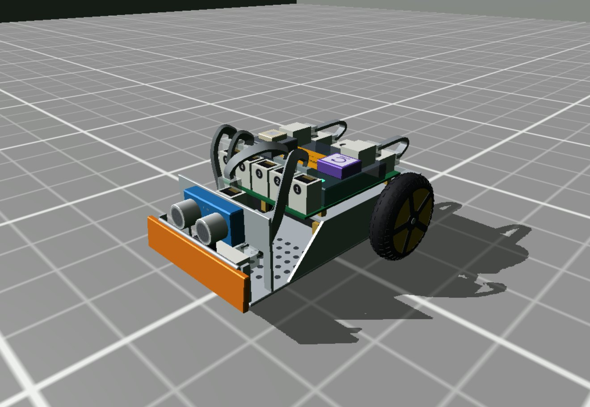

# Xe lắp mô-đun

Xe 2 bánh kiểu xe kit bán lẻ (khung nhôm, motor giảm tốc TT, mạch chủ có nắp, cảm biến dạng mô-đun nối bằng dây RJ25). Toàn bộ hình 3D, hitbox, khối lượng và mô phỏng cảm biến trong thư mục này là mã viết riêng cho Sân Robot Ảo, không dùng thân hộp, bánh và cảm biến có sẵn của GEARS.

Đã có: khung, bánh thường, cảm biến và bảng lắp ráp kéo thả cảm biến. Chưa có: bánh omni, mecanum, tài liệu cho giáo viên.



## Dùng thử

- Menu **Robot → Chọn robot → Xe lắp mô-đun (2 bánh)**.
- Thử một bài có sẵn bằng xe này: thêm `&robot=xe-lap-rap` vào địa chỉ, ví dụ `index.html?baiTap=01-di-chuyen/01-tien-toi-o-dich&robot=xe-lap-rap`.
- Tháo lắp cảm biến: menu **Robot → Lắp ráp xe (kéo thả cảm biến)**.
- Xem hitbox: menu **Robot → Hiện hitbox của xe** (khung dây xanh lá).

Robot nào có trường `sraXe` trong tệp JSON thì được dựng bằng mã ở đây; robot không có trường đó (robot chuẩn `co-ban` của các bài cũ) vẫn do GEARS dựng như trước.

## Các tệp

| Tệp | Việc |
|---|---|
| `hinh-khoi.js` | Toán: khối đặc (hộp, trụ, cầu, lăng trụ đáy lồi), thể tích, trọng tâm, mô-men quán tính, khoảng cách tới mặt khối. Không phụ thuộc trình duyệt, chạy được bằng Node. |
| `linh-kien.js` | Danh mục linh kiện và hàm `lapXe(cấu hình)`: mỗi chi tiết là một danh sách khối đặc kèm vật liệu và khối lượng. |
| `dung-hinh.js` | Sinh lưới 3D từ các khối (vát cạnh, nhãn, lưới loa siêu âm, gai lốp, nan vành, dây). |
| `vat-li.js` | Vật thể, khớp, motor và bước tính vật lí (Bullet qua Ammo.js). |
| `cam-bien.js` | Mô phỏng 5 loại cảm biến theo nguyên lí linh kiện thật. |
| `xe.js` | Nối xe vào GEARS: nạp robot, giao diện bánh và cảm biến mà khối lệnh, Python đang dùng. |
| `bang-lap-rap.js`, `.css` | Bảng lắp ráp: khay linh kiện, sơ đồ xe, kéo thả, lưu bản lắp của người dùng. |

Một bản mô tả khối duy nhất sinh ra cả ba thứ: hình nhìn thấy, hình va chạm, khối lượng. Vì vậy sửa kích thước một chi tiết ở `linh-kien.js` thì ba thứ cùng đổi.

Sau khi sửa `linh-kien.js`, chạy `node scripts/robot/tao-xe.js` để sinh lại `robots/xe-lap-rap.json`.

## Linh kiện của xe mặc định

Hệ trục xe: gốc ở mặt sân, ngay dưới điểm giữa trục hai bánh; x sang phải, y lên, z ra trước. Đơn vị cm, gam, giây.

| Nhóm | Chi tiết | Khối lượng |
|---|---|---|
| Khung | Khung nhôm chữ U dày 2 mm, tấm đáy 9 × 17 cm | 149 g |
| Động cơ | 2 motor giảm tốc TT 1:48 | 2 × 29 g |
| Pin | Hộp 2 pin 18650 | 104 g |
| Mạch chủ | Mạch in, nắp, 8 ổ RJ25, 4 trụ đồng | 56 g |
| Bánh | 2 bánh Ø 6,37 cm (chu vi 20 cm), rộng 1,8 cm, lốp cao su mặt cắt tròn | 2 × 29 g |
| Bi tự do | Bi thép Ø 1,6 cm và vỏ | 17 g + 6 g |
| Dò line | 2 mô-đun TCRT5000, cách nhau 3 cm, mặt đo cao 6 mm | 2 × 7,5 g |
| Siêu âm | HC-SR04 và giá đỡ | 25 g |
| Chạm | Công tắc hành trình, tấm cản có bản lề và lò xo | 9 g + 10 g |
| Gyro, GPS | Hai mô-đun đặt trên nắp mạch chủ | 6 g, 13 g |
| Dây | 6 dây RJ25 dẹt | 21 g |

Cả xe 549 g, 273 khối va chạm. Hai bánh cách nhau 11,4 cm (tâm đến tâm). Trọng tâm cao 3,6 cm, nằm trước trục bánh 3,5 cm; khoảng hai phần ba trọng lượng đè lên hai bánh chủ động.

| Cổng | Thiết bị |
|---|---|
| A (`outA`) | Bánh trái |
| B (`outB`) | Bánh phải |
| 1, 2 | Dò line trái, phải (lỗ thứ 2 và thứ 4 dưới mũi xe) |
| 3 | Siêu âm |
| 4 | Chạm (công tắc ở lỗ thứ 5) |
| 5 | Gyro |
| 6 | GPS |

## Chỗ gắn cảm biến và bảng lắp ráp


Xe có 8 chỗ gắn cảm biến:

| Chỗ gắn | Nhận | Ổ trên mạch chủ |
|---|---|---|
| Giá phía mũi | Siêu âm | Ổ trước còn trống gần giữa nhất (ưu tiên ổ 3) |
| 5 lỗ dưới mũi xe, x = −3; −1,5; 0; 1,5; 3 cm | Mắt dò line (nhiều nhất 3) hoặc công tắc chạm (nhiều nhất 1) | Lỗ thứ i cắm ổ i, dây đi thẳng, không bắt chéo |
| 2 chỗ trên nắp mạch chủ (trái, phải) | Gyro hoặc GPS | Ổ 6 (trái), ổ 8 (phải) |

Trong bảng lắp ráp, kéo một cảm biến từ khay vào chỗ gắn, kéo từ chỗ này sang chỗ khác, kéo vào chỗ đang có cảm biến cùng nhóm để đổi chỗ, kéo ra ngoài bảng để tháo. Không kéo được thì bấm cảm biến rồi bấm chỗ gắn; bàn phím dùng Tab, Enter và Delete. Mỗi lần đổi, xe 3D được dựng lại ngay: hình, hitbox, khối lượng và mô phỏng cảm biến đều tính lại từ danh mục linh kiện. Sơ đồ trong bảng vẽ chỗ gắn to hơn thật và tách khỏi thân xe cho dễ kéo; vị trí thật là trên xe 3D.

Số cổng trong chương trình đánh liền nhau theo thứ tự: các mắt dò line từ trái sang phải, siêu âm, chạm, gyro, GPS. Thêm bớt cảm biến thì số cổng của các cảm biến đứng sau đổi theo; bảng ghi số cổng trên từng cảm biến. Số ổ in trên mạch chủ (1 đến 8) là chỗ cắm dây, không phải số cổng trong chương trình.

Bản lắp của người dùng lưu trên máy đang dùng (`localStorage`, khoá `sanRobotAo.xeLapRap`) và được dùng lại mỗi khi chọn "Xe lắp mô-đun". Nút **Về mặc định** xoá bản đã lưu. Bài học nào chỉ định robot thì dùng đúng tệp robot của bài, không dùng bản đã lưu.

Cấu hình lắp là trường `sraXe` trong tệp robot:

```json
{ "sieuAm": true, "lo": [null, "doLine", null, "doLine", "cham"], "nap": ["gyro", "gps"] }
```

`lo` là 5 lỗ dưới mũi từ trái sang phải, `nap` là 2 chỗ trên nắp mạch chủ. Kiểu viết cũ vẫn dùng được: `doLine` (0 đến 3 mắt), `cachMat` (cm giữa hai mắt), `cham`, `gyro`, `gps` (true/false); hai mắt đặt lệch lỗ (ví dụ `cachMat: 2`) vẫn lắp đúng chỗ đã ghi. Cảm biến nào tháo thì mô-đun, dây và hitbox của nó biến mất, khối lượng xe giảm theo (từ 448 g khi tháo hết đến 561 g khi gắn đủ 3 mắt dò line).

## Vật lí

- **Đơn vị thật.** Trọng lực 981 cm/s² gán cho từng vật thể của xe (GEARS đặt 98,1 cho cả sân).
- **Hitbox.** Thân xe là tổ hợp mọi khối của mọi chi tiết gắn cứng vào khung; không có hộp bao. Bánh, bi tự do, tấm cản là vật thể riêng nối với thân bằng khớp.
- **Bước tính.** Mỗi khung hình chia thành các bước 1/240 giây; bộ giải ràng buộc lặp 120 vòng.
- **Motor.** Mô-men tại trục ra: T = T_kẹt × (u − ω/ω₀), với u là độ rộng xung PWM từ −1 đến 1. Thông số TT 1:48 ở 6 V: không tải 200 vòng/phút, mô-men kẹt 0,8 kgf·cm, ma sát hộp số 0,06 kgf·cm, quán tính rôto nhân với bình phương tỉ số truyền. Tốc độ do bộ điều khiển PI theo encoder giữ; ba kiểu dừng: giữ (PD theo góc), phanh (chập cực), thả trôi.
- **Điều khiển từng bánh.** Mỗi bánh có motor riêng. Chuyển động của xe là kết quả của lực ma sát tại hai bánh và bi, không có chỗ nào tính sẵn chuyển động của thân.
- **Lốp.** Lốp mặt cắt tròn nên chạm sân ở đúng giữa bề rộng lốp. Lốp trụ phẳng tuyệt đối cứng thì điểm chạm có thể rơi bất kì đâu trên bề rộng 1,8 cm, đo được xe quay lệch ±4 % so với lí thuyết.

## Cảm biến

| Cảm biến | Mô phỏng |
|---|---|
| HC-SR04 | 37 tia trong hình nón 15°. Tiếng vọng sớm nhất quyết định kết quả; mặt nghiêng quá 30° không cho tiếng vọng. Khoảng cách = thời gian vọng × 343 m/s ÷ 2. Tầm 2 đến 400 cm, bước 0,3 cm, 50 ms một lần đo. |
| TCRT5000 | 15 tia trong vùng nhìn đường kính khoảng 6 mm. Tín hiệu = hệ số phản xạ hồng ngoại × đáp ứng theo khoảng cách (mạnh nhất ở 2,5 mm). Hệ số phản xạ = 0,04 + 0,86 × max(R, G, B): mực màu gần như trong suốt với hồng ngoại 950 nm, chỉ màu đen hấp thụ. Có ngõ tương tự 0 đến 1023 (`docTuongTu`) và ngõ số có trễ (`docSo`). |
| Chạm | Tấm cản là vật thể thật, treo bản lề, có lò xo. Công tắc đóng khi tấm bị ép còn cách thân dưới 3°, mở lại khi quá 4°. |
| Gyro | Cộng dồn vận tốc góc của thân mỗi bước vật lí. Có thể bật trôi và nhiễu. |
| GPS | Toạ độ ăng-ten, 10 lần mỗi giây. Có thể bật sai số. |

Nhiễu, trôi, sai số mặc định tắt. Bật trong tệp robot, ví dụ `"sraCamBien": { "sieuAm": { "nhieu": 0.3 }, "gyro": { "troi": 0.5 }, "gps": { "saiSo": 2 } }`.

Các khối lệnh và thư viện Python có sẵn đọc được cả 5 cảm biến. TCRT5000 đứng ở chỗ của cảm biến màu, nên khối "độ sáng phản xạ" trả về 0 đến 100 %.

## Số đo

Đo trong trình duyệt không màn hình, khung nhìn 480 × 360.

| Phép đo | Kết quả | Lí thuyết |
|---|---|---|
| Hai bánh 400 °/s | 22,22 cm/s | 22,22 cm/s |
| Chạy thẳng 1 m | lệch hướng dưới 0,1° | 0° |
| Quay hai bánh 720° | 39,94 cm, bánh dừng lệch dưới 0,01° | 40,00 cm |
| Một bánh 300 °/s, bánh kia giữ | xoay 83,6 °/s, bán kính 5,66 cm | 83,8 °/s, 5,70 cm |
| Quay tại chỗ ±300 °/s | 166,8 °/s, tâm quay lệch 0,4 mm sau 1,2 vòng | 167,5 °/s |
| Đứng yên 3 giây | trôi 0,01 mm | 0 |
| Dừng từ 22 cm/s | giữ 0,7 cm, phanh 2,6 cm, thả trôi 8,5 cm | |
| Hitbox so với hình vẽ | lệch lớn nhất 0,9 mm | dưới 1 mm |
| Hitbox trong Bullet so với khối | lệch lớn nhất 0,4 mm | dưới 1 mm |
| Siêu âm, tường 3 đến 390 cm | sai lớn nhất 0,1 cm | |
| Dò line, mép vạch đen | lệch 0,4 mm | |
| Gyro sau khi xoay 445° | lệch 0,000° | |
| Tốc độ khung hình | 51,6 (robot chuẩn cũ: 60) | từ 30 trở lên |

## Giới hạn đã biết

Những chỗ mô hình chưa đúng hẳn với xe thật, kèm mức sai đã đo hoặc ước lượng:

- **Lốp.** Hình va chạm là trụ bo mép; khối lượng và quán tính của lốp vẫn tính như ống trụ không bo (lốp 20 g, sai quán tính bánh ước dưới 5 %). Lốp cứng tuyệt đối, không biến dạng.
- **Quán tính thân.** Chỉ dùng ba thành phần chéo của tenxơ quán tính; các thành phần ngoài chéo (dưới 2 %) bị bỏ.
- **Hình ghép của Bullet.** Khi một chi tiết của thân hoặc tấm cản tựa đúng lên một mặt phẳng, tiếp xúc có thể mất trong một bước tính rồi có lại, gây rung tới 0,17 mm. Bánh và bi không bị vì dùng hình đơn.
- **Hoạ tiết.** Lỗ vít trên khung, khe giữa các nan vành, gai lốp, lưới loa siêu âm là hình vẽ nổi dưới 1 mm, không khoét vào hitbox.
- **Dây RJ25.** Dây cứng, không đung đưa. Hitbox là chuỗi hộp ngắn, lệch khỏi dải dây vẽ nhiều nhất 0,5 mm.
- **Motor.** Chưa mô phỏng điện cảm cuộn dây, độ rơ bánh răng, pin sụt áp.
- **HC-SR04.** Mô hình tia hình học: không có phản xạ nhiều lần, không có nhiễu chéo. Ngưỡng 30° là cắt đứt, cảm biến thật yếu dần.
- **TCRT5000.** Đường đáp ứng theo khoảng cách đọc từ đồ thị trong tài liệu kĩ thuật. Hệ số phản xạ hồng ngoại suy ra từ màu nhìn thấy; vật liệu thật có thể khác (nhựa đen bóng vẫn phản xạ hồng ngoại mạnh).
- **Chưa có bút vẽ.** Các bài vẽ hình cần robot chuẩn cũ.
- **Không nhận màu.** TCRT5000 chỉ phân biệt sáng và tối, nên bài phân loại ô màu không làm được bằng xe này.
- **Bài cũ căn theo robot cũ.** Vùng chấm điểm sát tường và quãng trôi khi phanh trong các bài cảm biến chạm, khoảng cách được đo theo kích thước và quán tính của robot `co-ban`. Xe mới dài hơn và dừng gấp hơn nên nhiều lời giải mẫu không đạt đủ sao.

## Kiểm tra tự động

```bash
cd public && python3 -m http.server 1337 &
node scripts/xe/kiem-tra-hitbox.js          # hình vẽ, khối và hình trong Bullet khớp nhau dưới 1 mm
node scripts/xe/kiem-tra-chuyen-dong.js     # 15 phép đo chuyển động so với lí thuyết
node scripts/xe/kiem-tra-cam-bien.js        # 27 phép đo cảm biến với đáp số biết trước
node scripts/xe/kiem-tra-lap-rap.js         # 1414 bản lắp đều dựng được; kéo thả, bấm chọn, bàn phím, lưu lại
SIRO_LAP='{"lo":["doLine","cham","doLine","doLine",null]}' node scripts/xe/kiem-tra-hitbox.js   # hitbox của một bản lắp khác
node scripts/xe/do-fps.js                   # tốc độ khung hình, so với robot chuẩn
node scripts/xe/chup-anh.js thu-muc         # chụp xe từ 9 góc
SIRO_ROBOT=xe-lap-rap node scripts/thu-thach/kiem-tra-bai.js 01-di-chuyen/01-tien-toi-o-dich   # chạy bài cũ bằng xe mới
```

Cần Playwright. Mỗi lệnh thoát với mã 0 khi mọi mục đạt.
